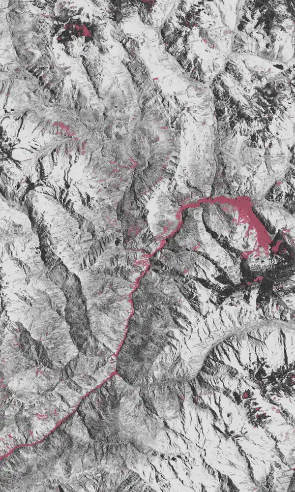
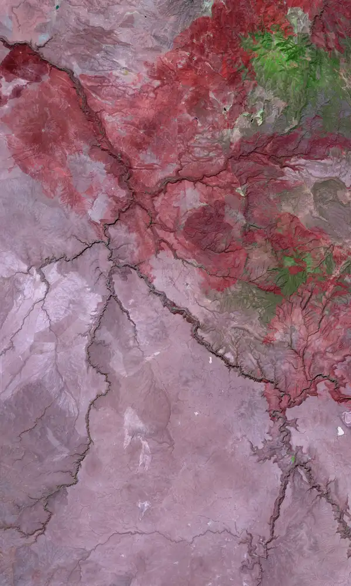
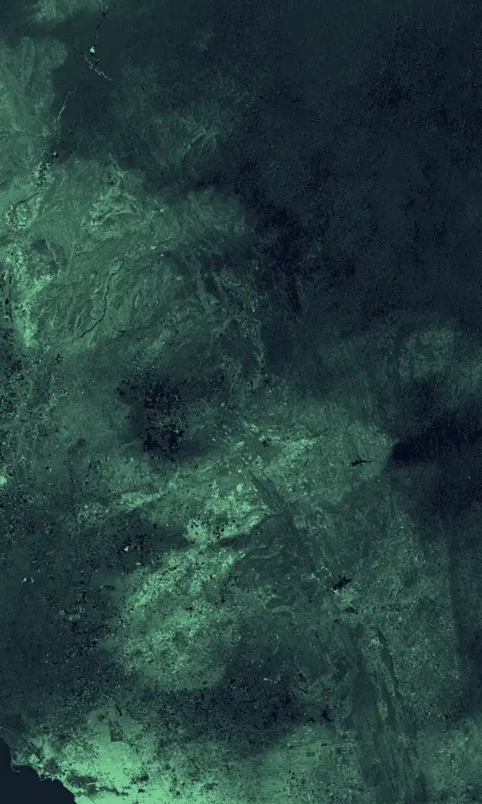

<p align="center">
  
</p>

<p align="center">
  <a href="https://www.spaceappschallenge.org/"></a>
  
  <br>
  
  
  
  
</p>

<p align="center"><b>In the summer of 2026, the ground changed faster than cameras could follow.<br>Piercer follows NASA-ISRO's NISAR radar through three of those changes, and lets you check every finding against the evidence.</b></p>

## ✦ Summary

**Piercer** is an interactive 3D documentary for the NASA Space Apps Challenge 2026, challenge *Dancing with the SARs*. Clouds, smoke and night hide the ground from ordinary satellite cameras exactly when it changes most. Radar sees through all three. On a 3D globe, Piercer flies to three places that changed in 2026 at three speeds: a flood surge from an ice-and-rock collapse in Nepal in minutes, a wildfire in Oregon over weeks, and the rainy season in Jazan, Saudi Arabia. Each story plays on a timeline, shows what NISAR's radar recorded beside what the photos could (or could not) show, and labels every number as measured, derived, reported or estimated, so anyone can check the finding against the data.

*Piercer*: radar pierces the cloud, smoke and darkness that hide the ground from ordinary cameras.

## ✦ The journey

Three places, three speeds of change, one season. Each place earns its chapter with a question, an observation you can inspect, an interaction and a reason it matters.

<table>
  <tr>
    <td align="center" width="33%"><br><sub><b>MINUTES</b> · Bhote Koshi, Nepal</sub></td>
    <td align="center" width="33%"><br><sub><b>WEEKS</b> · Oregon's Fire, USA</sub></td>
    <td align="center" width="33%"><br><sub><b>A SEASON</b> · Jazan, Saudi Arabia</sub></td>
  </tr>
</table>

| | Place | The change | What radar did | Key evidence |
|---|---|---|---|---|
| **Minutes** | Bhote Koshi, Rasuwa, Nepal | An ice-and-rock collapse sent a surge 59.5 km down the valley on 26 Aug 2026 | **Through the cloud.** Five days later, 38% (31–46%) of the flood corridor had changed against 7.3% of the slopes beside it, five weeks before the first clear photo | NISAR GUNW coherence pairs; HLS stripped ground 11.7 km² (11.0–12.6) |
| **Weeks** | Oregon's Fire (NIFC: Big Grass Fire), Oregon–Idaho | Lightning on 23 Jul; 1,810 km² (1,610–1,950) burned by late August | **Beyond the smoke.** In October the photos look green again, but the radar shrub signal on the hottest-burned ground is at 51% of its pre-fire level (81% outside) | NISAR GCOV HV; HLS dNBR; VIIRS fire days; NIFC perimeter |
| **A season** | Jazan, Saudi Arabia | Storms off the Sarawat mountains; the coastal plain greens from mid-September, the coast last | **Where the green came.** Ground the dawn radar kept flagging through the rains was 2.2–2.9× as likely to be green by November (a match in place, not a lead time) | NISAR GUNW and GCOV (dusk and dawn passes); IMERG rain; HLS green-up dates |

The finale puts all three on one axis (June–November 2026), with every NISAR pass and the gap with no NISAR data (27 July – 10 August) that the three places share.

### How it works

- **The landing page** shows a turning Earth and explains the idea and how NISAR's radar works as you scroll; the button or the end of the page opens the globe.
- **The globe** shows the three places with cards that stay beside them as it turns. Hover or focus a card and the globe turns to face it.
- **Each place** has six chapters. The camera flies to a viewpoint chosen for the evidence (along the gorge, over the fire's origin, from the Red Sea toward the escarpment). Time plays where the story needs it: the surge minute by minute, the fire day by day, the season week by week.
- **Explore freely at any time:**
  - drag to move, scroll or pinch to zoom, right-drag or shift-drag to turn and tilt;
  - scrub the timeline or click a dated event;
  - switch layers (photo, false colour, radar change, wet ground…) and the dusk or dawn radar pass;
  - click a radar pair in the Nepal chart to load it on the map.

  Any input interrupts a camera flight at once. **Back to the story view** (or `R`) returns to it.
- **Keyboard:**

  | Key | Action |
  |---|---|
  | `←` `→` | Chapters and places |
  | `Space` | Play or pause |
  | `R` | Back to the story view |
  | `+` `−` | Zoom |
  | `Q` `E` | Turn |
  | `Alt`+arrows | Move the camera |
  | `Esc` | The globe |

- **Reduced motion:** cuts replace flights, guided playback jumps to its end state, and the clouds stop moving.
- **Phones:** the 3D view on top, a reading sheet below.

## ✦ Run it

Needs Node 20 or newer.

```bash
npm install
npm run dev        # then open the printed address
```

The prepared data is already in `public/data`. To rebuild it from the sources:

```bash
npm run data       # fetches the team's research repo and the globe, builds public/data, runs the checks
```

| Command | What it does |
|---|---|
| `npm run data:research` | Downloads the research repository into `data-src/research` |
| `npm run data:globe` | NASA Blue Marble globe from NASA GIBS (only if missing) |
| `npm run data:build` | Builds `public/data/sites/*`: reprojected layers, Copernicus DEM terrain, browser imagery, standardized numbers. Add `--no-images` to skip the imagery |
| `npm run data:verify` | Georeference and data checks (below) |
| `npm run build` / `npm run preview` | Type-check and build the static site into `dist/`, then serve it |
| `npm run check` | Drives the running dev server through the whole journey in headless Chrome (needs Google Chrome) and saves screenshots |

## ✦ Data (NASA datasets used)

Piercer does not measure anything new. It builds on the team's research (`research/` in [the project repository](https://github.com/BASIL960/Piercer-Dancing-with-the-SARs--nasa-space-app-2026-)). That research follows one data standard for all three places (`research/DATA_STANDARD.md`) and lists every number with its rule, control and source (`research/CLAIMS.md`). The build script copies those standardized results (`research/std_*.json`) into the site data, so the copy reads its numbers from data rather than typing them in.

| Dataset | Used for |
|---|---|
| NASA-ISRO NISAR L2 GUNW (coherence), provisional | Radar ground change: Nepal track 98, Oregon track 114, Jazan tracks 64 (18:39) and 71 (05:39) |
| NASA-ISRO NISAR L2 GCOV (calibrated γ⁰), provisional | Jazan wet ground (HH); Oregon shrub structure (HV) and radar views |
| NASA HLS v2 (Landsat 8/9 + Sentinel-2) | Photos, burn extent and severity, stripped ground, green-up and open water |
| NASA GPM IMERG V07, Late run | Jazan rain, daily and half-hourly |
| NASA VIIRS 375 m active fire | Day-by-day spread of the fire |
| Copernicus DEM GLO-30 (ESA, AWS Open Data) | Terrain in 3D (read directly from the public tiles), flood route, Jazan coastal plain |
| NIFC perimeters | Official Big Grass perimeter |
| NASA Blue Marble via GIBS | The globe |

Every statement on screen carries a label:
- **Measured:** read from a calibrated product, with no threshold.
- **Derived:** computed with a stated rule, compared with a control, and given a range from nudging the threshold.
- **Reported:** from official bodies or the news, with the source named.
- **Estimated:** animation between observations, never quoted as a finding.
- **Interpretation:** a reading of why, not proven.
- **Illustrative:** lighting, clouds, the cloud veil, stars.

NASA does not endorse this project.

## ✦ Placing the research on the globe

The research layers are north-up UTM grids, stored in "context pixel" coordinates, without their grid origin. `scripts/stories/georef.mjs` recovers each origin from points whose latitude and longitude are known: the ignition point, the flood source, and every IMERG rain-cell pin. Terrain is then sampled from the Copernicus DEM onto the same grids, and the browser drapes each layer on the sphere through an exact UTM-to-latitude conversion (`src/engine/utm.ts`, within 3 mm of proj4).

## ✦ What was checked

| Check | Result |
|---|---|
| Georeference (`check-georef.mjs`) | The Jazan rain-cell pins agree to 1.1 m. The IMERG grid corners land on 18.6°N 41.9°E and 16.4°N 43.6°E exactly. Town labels sit 1–174 m from gazetteer positions (the gazetteer itself is approximate) |
| Terrain alignment (`verify.mjs`) | Our DEM along the research's Nepal flood route matches its own elevation profile: median difference 20 m over a 4,300 m drop. The Jazan coastal plain recomputed from our terrain: 4,262 km² vs the research's 4,256 km² |
| Words against data (`verify.mjs`) | Season rain 169 mm, August 53 mm, wettest day 12 Aug (18.6 mm mean, 36 mm cell), "5 of 8 dusk passes / no dawn pass", "only the flood pair separates corridor and slopes", HV 51% vs 81%: all recomputed from the site data |
| Journey (`npm run check`) | All 18 chapters, layer and pass switches, the hub and the finale, in headless Chrome at 1440×900; intro, hub, one chapter per place and the finale at 390×844. Dragging mid-flight takes the camera; hopping chapters mid-flight re-targets smoothly; scrubbing stops playback. No console errors and no failed requests |
| Production build | Builds; the built site loads and runs the first chapters by real clicks and keys with no errors |

Not tested: Safari, Firefox, real phones and tablets, screen readers.

## ✦ Limitations

- **Provisional products.** NISAR products are provisional; validated versions start on 21 October 2026. IMERG is the near-real-time Late run.
- **NISAR data gap.** There is no NISAR data from 27 July to 10 August 2026, so the Oregon radar pair across the fire spans 36 days.
- **Radar shows change, not cause.** Coherence loss says the surface changed, not why; explanations come from photos, rainfall, elevation and reports.
- **Estimated fronts.** The moving fire and flood fronts and the counters that grow between observations are estimates; their end values are measured.
- **Late green and water dates.** These are the first clear photo showing the change, so they can be a few days late.
- **Exaggerated relief.** Terrain is raised for legibility (×1.15 Nepal, ×2.4 Oregon, ×2.2 Jazan, shown on screen). The regional terrain uses a coarser DEM grid (~410–560 m) than the study areas (~105–185 m).
- **Reported figures.** Deaths, acres, containment and alert texts are reported and were not recomputed.
- **Data size.** About 74 MB of imagery in total, loaded place by place.

## ✦ Project layout

```
scripts/stories/
  fetch-research.mjs   downloads the research repo into data-src/research
  georef.mjs           recovers each layer's UTM origin from known points
  dem.mjs              Copernicus DEM tiles (range reads, cached in data-src/cache)
  build.mjs            builds public/data/sites/<place>/
  check-georef.mjs     prints and checks the georeference
  verify.mjs           alignment, denominators and copy-vs-data checks
  globe.mjs            the Blue Marble globe
scripts/check-journey.mjs   headless browser run of the whole journey
src/
  story.ts             places, chapters, camera views, layers, timelines
  store.ts             app state: place, chapter, time, playback, layers, free camera
  data.ts              data types, loaders, local time
  engine/              three.js: globe, terrain, site scenes (fire, flood, rain season), camera, shaders
  ui/                  React: intro, globe hub, reading panels, evidence charts, timeline, finale, sources
```

## ✦ Team

**Team Lūx Stellārum** · NASA Space Apps 2026, Riyadh

| Member | Role |
|---|---|
| Bassam Albulaihi | AI Engineer (lead) |
| Basel Alhumaily | Project Manager |
| Abdulqader Alfawzan | Analyst |

## ✦ Built with

three.js, React, Vite, zustand, proj4, geotiff.js and sharp. Typefaces: Reem Kufi and Readex Pro (SIL Open Font License).

**Use of AI:** code, data pipeline and interface text were written with Claude, an AI assistant made by Anthropic, working from the team's direction, research and reference material.

---

<p align="center">
  
  &nbsp;&nbsp;&nbsp;
  
  <br>
  <sub>Made for the <a href="https://www.spaceappschallenge.org/">NASA International Space Apps Challenge</a> 2026 · Saudi Arabia · 14–15 November 2026</sub>
</p>
